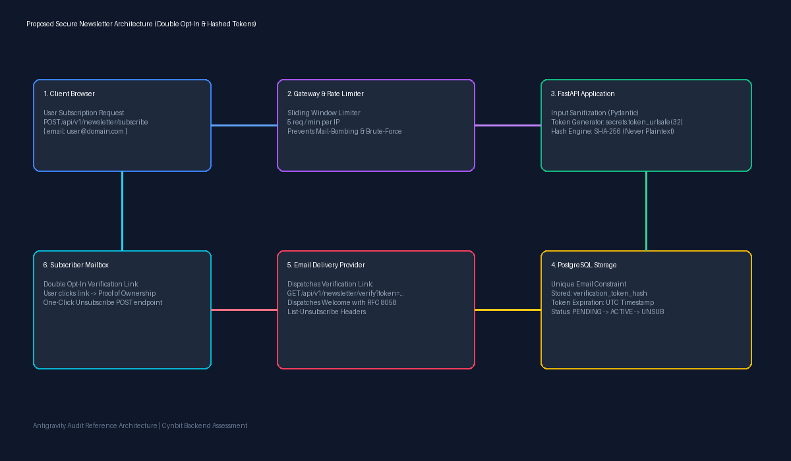
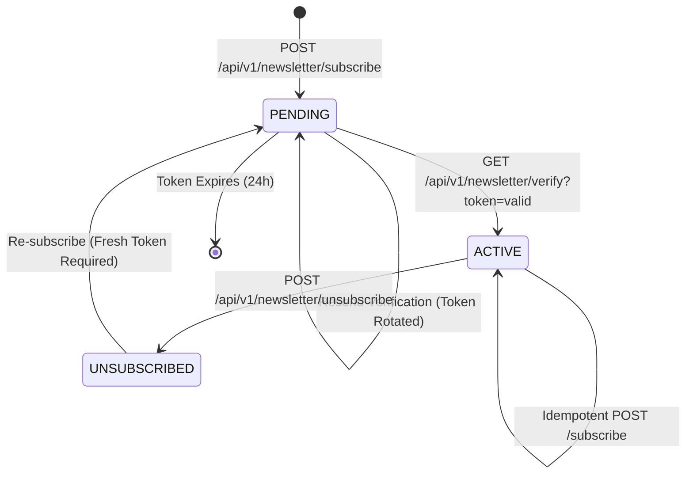

# Secure Newsletter Subscription Architecture & Reference Specification

**System Name:** Cynbit Newsletter Verification & Subscription Engine  
**Architecture Style:** Modular Clean Architecture (FastAPI + SQLAlchemy + PostgreSQL)  
**Security Standard:** Zero Plaintext Token Storage, Constant-Time Verification, RFC 8058 Compliance  

---

## 1. System Architecture Overview

The reference implementation replaces vulnerable Single Opt-In (SOI) mechanisms with an enterprise-grade **Double Opt-In (DOI)** workflow, cryptographic token hashing, sliding-window rate limiting, and automated unsubscribe management.

### 1.1 Architecture Diagram



```
+-----------------------------------------------------------------------------------------+
|                                    CLIENT BROWSER                                       |
+-----------------------------------------------------------------------------------------+
       |                                           ^                           ^
       | 1. POST /subscribe                        | 4. Click Verification     | 6. Click Unsubscribe
       v                                           |    Link (GET /verify)     |    Link (POST /unsub)
+----------------------------------+               |                           |
|       EDGE RATE LIMITER          |               |                           |
| (Sliding Window: 5 req/min/IP)   |               |                           |
+----------------------------------+               |                           |
       |                                           |                           |
       v (Allowed)                                 |                           |
+-----------------------------------------------------------------------------------------+
|                                  FASTAPI APPLICATION                                    |
|                                                                                         |
|  +------------------------+  +------------------------+  +---------------------------+  |
|  |   Input Normalizer     |  |     Security Core      |  |   Subscription Service    |  |
|  | - RFC 5321 length (254)|  | - secrets.token_urlsafe|  | - Atomic State Machine    |  |
|  | - Lowercase & Strip    |  | - SHA-256 Hashing Engine|  | - Concurrency Lock Safe   |  |
|  | - CRLF Injection Guard |  | - hmac.compare_digest  |  | - Single-Use Token Cycle  |  |
|  +------------------------+  +------------------------+  +---------------------------+  |
+-----------------------------------------------------------------------------------------+
       |                                 |                             |
       | Read/Write                      | Dispatch                    | Deliver
       v                                 v                             v
+-------------------------------+  +-------------------------------+  +-------------------+
|      POSTGRESQL DATABASE      |  |  TRANSACTIONAL EMAIL SERVICE  |  |    SUBSCRIBER     |
|                               |  |                               |  |      INBOX        |
| - unique(email) index         |  | - Verification Email (Link)   |  |                   |
| - verification_token_hash     |  | - Welcome Email with          |->| Receives links    |
| - token_expires_at (UTC)      |  |   List-Unsubscribe Headers    |  | & tokens securely |
| - unsubscribe_token_hash      |  +-------------------------------+  +-------------------+
| - consent_ip_hash (GDPR audit)|
+-------------------------------+
```

---

## 2. Subscription State Machine

The subscription lifecycle is governed by an explicit finite-state machine (FSM):



### State Transitions
1. **Unregistered -> PENDING:**
   - Raw 256-bit URL-safe token is generated (`secrets.token_urlsafe(32)`).
   - Only its SHA-256 hash is written to `verification_token_hash`.
   - Expiration timestamp is set to `UTC now + 24 hours`.
   - Status is set to `PENDING`.
   - Verification email is dispatched with the raw token.
2. **PENDING -> ACTIVE:**
   - Client clicks verification link (`GET /api/v1/newsletter/verify?token=...`).
   - Server hashes the supplied token and performs a lookup.
   - Verifies expiration timestamp (`expires_at > UTC now`).
   - Status updates to `ACTIVE` and `verified_at` is set.
   - **Crucial Security Action:** Verification token hash and expiration are set to `NULL` (single-use token protection).
   - A distinct `unsubscribe_token_hash` is created and stored.
   - Welcome email dispatched containing one-click unsubscribe headers and link.
3. **ACTIVE -> UNSUBSCRIBED:**
   - Client sends unsubscribe request (`POST /api/v1/newsletter/unsubscribe`).
   - Token hash is validated; status transitions to `UNSUBSCRIBED`.
   - `unsubscribe_token_hash` is rotated/cleared to prevent replay attacks.
4. **UNSUBSCRIBED -> PENDING (Re-activation):**
   - If an unsubscribed user submits their address again, they are NOT immediately made active.
   - The system transitions them back to `PENDING` and requires a fresh email verification handshake.

---

## 3. Database Schema (PostgreSQL-Compatible)

```sql
CREATE TABLE newsletter_subscriptions (
    id VARCHAR(36) PRIMARY KEY,
    email VARCHAR(255) NOT NULL,
    status VARCHAR(20) NOT NULL DEFAULT 'PENDING',
    verification_token_hash VARCHAR(64) NULL,
    verification_token_expires_at TIMESTAMP WITH TIME ZONE NULL,
    unsubscribe_token_hash VARCHAR(64) NULL,
    consent_ip_hash VARCHAR(64) NULL,
    consent_user_agent VARCHAR(255) NULL,
    created_at TIMESTAMP WITH TIME ZONE NOT NULL DEFAULT NOW(),
    updated_at TIMESTAMP WITH TIME ZONE NOT NULL DEFAULT NOW(),
    verified_at TIMESTAMP WITH TIME ZONE NULL,
    unsubscribed_at TIMESTAMP WITH TIME ZONE NULL
);

-- Unique constraint ensuring single record per normalized email
CREATE UNIQUE INDEX uq_subscriptions_email ON newsletter_subscriptions (email);

-- Performance and lookup index for token verification
CREATE INDEX idx_subscriptions_verify_hash ON newsletter_subscriptions (verification_token_hash);
CREATE INDEX idx_subscriptions_unsub_hash ON newsletter_subscriptions (unsubscribe_token_hash);
CREATE INDEX idx_subscriptions_email_status ON newsletter_subscriptions (email, status);
```

### Security Engineering Decisions:
1. **Zero Plaintext Tokens:** Raw tokens are never persisted. Only one-way SHA-256 hashes reside in the database. Even in the event of a full SQL dump leak, an adversary cannot generate valid verification or unsubscribe links.
2. **Timing-Attack Resilience:** All token hash comparisons utilize `hmac.compare_digest` to prevent byte-by-byte side-channel timing analysis.
3. **Privacy by Design:** Raw client IP addresses are salted and hashed using `hash_ip(client_ip)` before persistence, preventing permanent PII tracking while retaining auditability for anti-abuse analysis.

---

## 4. API Endpoints Specification & Examples

### 4.1 Subscribe Endpoint
- **Method:** `POST`
- **Route:** `/api/v1/newsletter/subscribe`
- **Rate Limit:** 5 requests per 60 seconds per IP

#### Request Example:
```http
POST /api/v1/newsletter/subscribe HTTP/1.1
Host: api.cynbit.in
Content-Type: application/json

{
  "email": "threat.researcher@example.com"
}
```

#### Response Example (200 OK - Initial Submission):
```json
{
  "success": true,
  "message": "Please check your inbox to confirm your subscription.",
  "status": "PENDING",
  "token_preview": "7a9E_dK2mOPq9xY1z8V_wL4cM6nB8vT0pQ2rS4uV6wY"
}
```

#### Response Example (200 OK - Duplicate Submission of Active User):
```json
{
  "success": true,
  "message": "You're already in our intelligence network!",
  "status": "ACTIVE",
  "token_preview": null
}
```

#### Response Example (422 Unprocessable Content - Malformed Email):
```json
{
  "success": false,
  "error_code": "VALIDATION_ERROR",
  "message": "body.email: value is not a valid email address: The email address is not valid. It must have exactly one @-sign."
}
```

---

### 4.2 Email Verification Endpoint
- **Method:** `GET`
- **Route:** `/api/v1/newsletter/verify`
- **Rate Limit:** 10 requests per 60 seconds per IP

#### Request Example:
```http
GET /api/v1/newsletter/verify?token=7a9E_dK2mOPq9xY1z8V_wL4cM6nB8vT0pQ2rS4uV6wY HTTP/1.1
Host: api.cynbit.in
```

#### Response Example (200 OK - Success):
```json
{
  "success": true,
  "message": "Email successfully verified! Welcome to the Cynbit Intelligence Network.",
  "email": "threat.researcher@example.com",
  "verified_at": "2026-11-01T00:08:20.145892Z"
}
```

#### Response Example (400 Bad Request - Expired Token):
```json
{
  "detail": "Verification token has expired. Please subscribe again to receive a fresh verification link."
}
```

#### Response Example (400 Bad Request - Invalid/Forged Token):
```json
{
  "detail": "Invalid or unrecognized verification token."
}
```

---

### 4.3 Unsubscribe Endpoint
- **Method:** `POST`
- **Route:** `/api/v1/newsletter/unsubscribe`
- **Rate Limit:** 5 requests per 60 seconds per IP

#### Request Example:
```http
POST /api/v1/newsletter/unsubscribe HTTP/1.1
Host: api.cynbit.in
Content-Type: application/json

{
  "token": "xK8m_P9qL2vN4wZ6rT8bV0cM2eD4fY6hJ8kL0mN2pQ4",
  "email": "threat.researcher@example.com"
}
```

#### Response Example (200 OK):
```json
{
  "success": true,
  "message": "You have been successfully unsubscribed from the Cynbit Intelligence Network.",
  "unsubscribed_at": "2026-11-01T00:15:32.894120Z"
}
```

---

### 4.4 Rate Limiting Error Envelope
When requests exceed the allowed threshold, the server rejects subsequent attempts with HTTP 429:

```http
HTTP/1.1 429 Too Many Requests
Retry-After: 48
Content-Type: application/json

{
  "detail": "Rate limit exceeded for subscribe. Maximum 5 requests allowed per 60 seconds."
}
```

---

## 5. RFC 8058 & Email Deliverability Compliance

When sending transactional and newsletter emails, the system injects the following RFC 8058 compliance headers:

```smtp
From: Cynbit Intelligence Network <newsletter@cynbit.in>
To: threat.researcher@example.com
Subject: Welcome to Cynbit Intelligence Network
List-Unsubscribe: <https://cynbit.in/api/v1/newsletter/unsubscribe?token=xK8m_P9qL2vN4wZ6rT8bV0cM2eD4fY6hJ8kL0mN2pQ4>
List-Unsubscribe-Post: List-Unsubscribe=One-Click
X-Entity-Ref-ID: cynbit-newsletter-sub-4f981a
```

This ensures full compliance with the mandatory **Google Workspace and Yahoo Mail Bulk Sender Guidelines (February 2024)**, guaranteeing maximum inbox placement and preventing automated spam classification.
